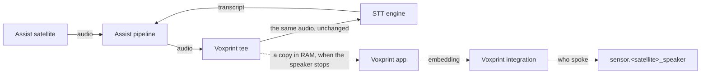

# How it works

## The tee

The Assist pipeline hands each utterance to its STT entity through
`internal_async_process_audio_stream_with_progress`, a method every STT entity inherits from Home
Assistant's base class. Voxprint shadows that method on each STT entity instance with a tee: every
chunk goes on to the engine unchanged, and is also appended to a buffer in RAM, up to the pipeline's
own 15-second cap. Results and exceptions pass through untouched, and so do the method's arguments,
including any a later Home Assistant adds. If anything in Voxprint fails, the tee passes the audio
through and captures nothing. Removing the integration drops the shadow, and the
class's method applies again.

Because it sits in front of the engine rather than replacing it, the tee works with any STT entity:
Home Assistant Cloud, Whisper over Wyoming, or anything else. It can't hear the legacy STT providers
that aren't entities, nor satellites that run speech-to-text on the device.

The method is internal to Home Assistant. If an update renames it or its `metadata` and `stream`
parameters, Voxprint leaves it alone: STT keeps working, the speaker sensors say `not_captured`, and
a repair says so.

## Which satellite spoke

A satellite switches to `listening` from inside the task that runs its pipeline, right before that
task calls the STT engine, and Home Assistant delivers state changes to listeners synchronously. So
when a configured satellite starts listening, Voxprint notes the running task, and the tee claims an
audio stream only when it runs in that same task. Audio from the companion app, the browser, an
automation or a satellite that isn't configured runs elsewhere and is never captured. Two satellites
talking at once each get their own result.

## Scoring

When the speaker stops, before the engine has finished transcribing, the integration sends the
captured audio to the app (`POST /v1/embed`, 16 kHz 16-bit mono PCM). The app:

1. scales the clip so its loudest samples sit near -20 dBFS (some satellites, the Voice PE among them,
   deliver speech around -60 dBFS);
2. keeps the 25 ms frames more than 10 dB above the clip's noise floor, at most 6 seconds of them;
3. computes 80-band filter banks, removes their per-utterance mean, and runs WeSpeaker ResNet34-LM,
   which returns a 256-number embedding.

The integration scores that embedding against each speaker's voiceprint: the cosine similarity to the
normalized mean of their enrolled embeddings. The best speaker is named when their score is at or
above the threshold, there was at least 0.5 s of speech, and no second speaker also clears the
threshold within 0.05 of them.

On a desktop CPU with the app limited to two cores, the model takes about 20 ms for 1 s of speech,
30 ms for 2 s and 90 ms for 6 s, and the app uses about 125 MiB. A Raspberry Pi takes a few times
longer, well inside the 3-second timeout.

## Failing closed

- The speaker sensor is reset to `unknown` (`error: listening`) as soon as its satellite listens, so a
  verdict never outlives its utterance. A request that reaches the satellite's pipeline without
  listening, such as speech-to-text on the satellite, resets it too. Each request also moves
  `last_updated`, which a script can check.
- A score that arrives after the satellite started a newer utterance is dropped.
- The app down, slower than 3 seconds, answering with another model, or with something unexpected:
  no speaker, and `error` says which.
- Less than 0.5 s of speech, nobody enrolled, or two speakers too close to tell apart: no speaker.
- Nothing Voxprint does can delay, change or fail speech-to-text.

## Enrollment

While a speaker's enrollment switch is on, each scored utterance joins their voiceprint, except when:

- it was spoken before the switch went on, or scored after it went off;
- it came from another satellite than the first one that heard the speaker in this session: someone
  talking to a satellite in another room can't join;
- it has less than 0.5 s of speech;
- it scores under 0.1 against the voiceprint so far (music, noise, a cough);
- another enrolled speaker scores above the threshold and higher than this one.

The first utterance is taken as it is, since there is nothing to compare it with. Being alone is what
keeps other people out. Only one speaker enrolls at a time, the switch turns itself off after 30
minutes and after every restart, and it is a configuration entity, which Home Assistant doesn't expose
to voice assistants unless you do: keep it that way, so nobody can ask Assist to enroll them.

## Privacy

| | |
|---|---|
| Captured | Audio of utterances from the configured satellites only, in RAM |
| Sent | That audio, to the app's URL, once per utterance. On Home Assistant OS this stays on the internal network |
| Kept by the app | Nothing. Audio lives for one request, nothing is written, and it needs no network after the build |
| Stored | Embeddings, never audio: at most 150 per speaker, as float16, in `/config/.storage/voxprint`, mode 0600 |
| Deleted | A speaker's embeddings when the speaker is removed or reset (if Voxprint is disabled then, when it next loads); the whole file when the integration is removed |
| In diagnostics | Counts, scores and errors, with speakers numbered. No names, persons, user IDs, addresses or embeddings |
| In logs | At debug level, the app logs each utterance's length and timing. The integration never logs who spoke |

An embedding is biometric data about a voice. It can't be turned back into audio, but it can tell
whether a recording is that person. Treat `.storage/voxprint`, and backups that contain it, like
other personal data.
